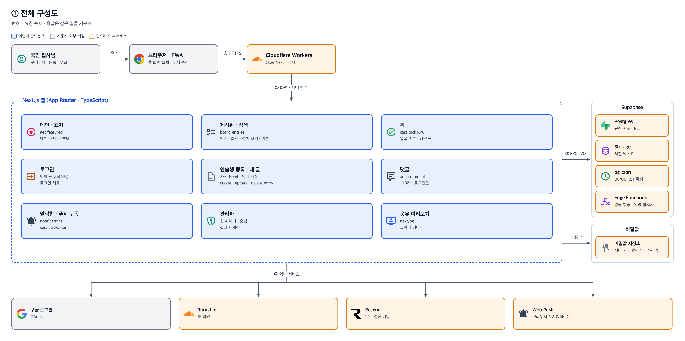
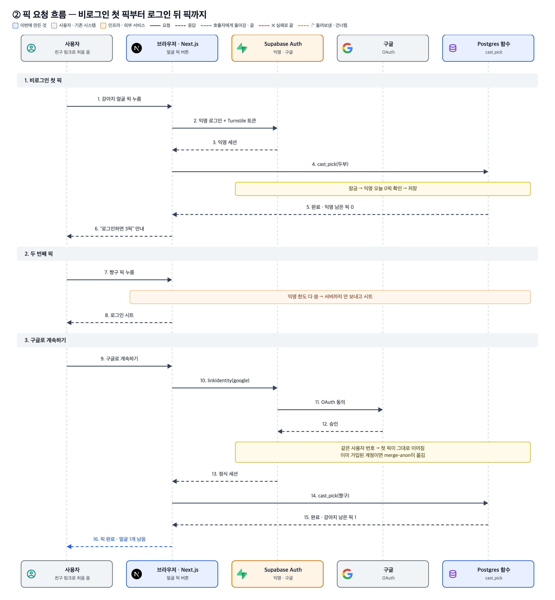
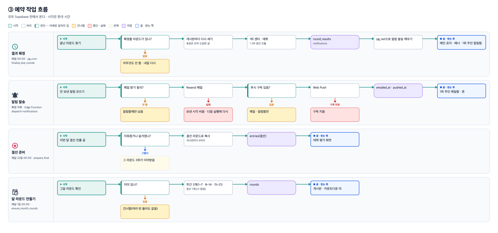
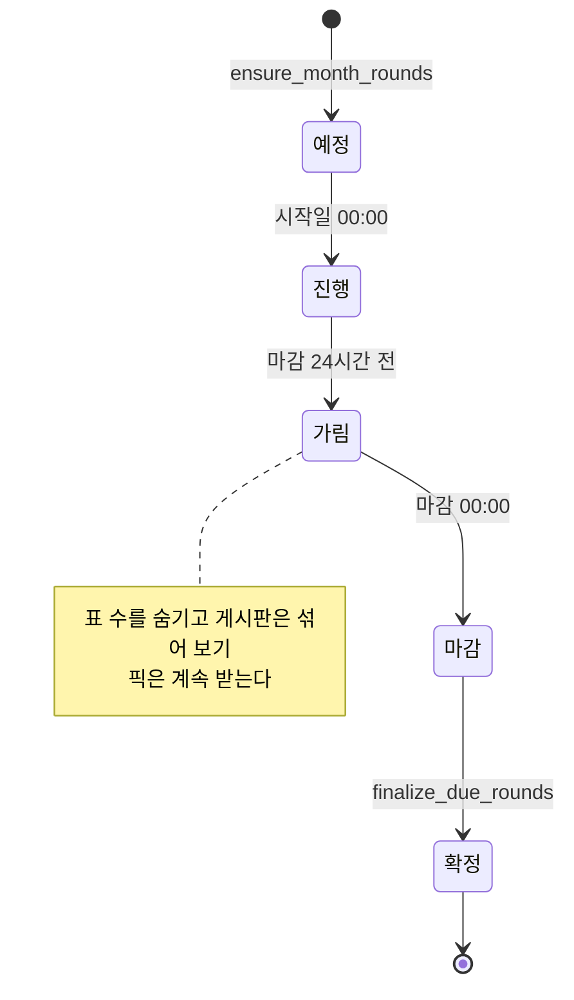
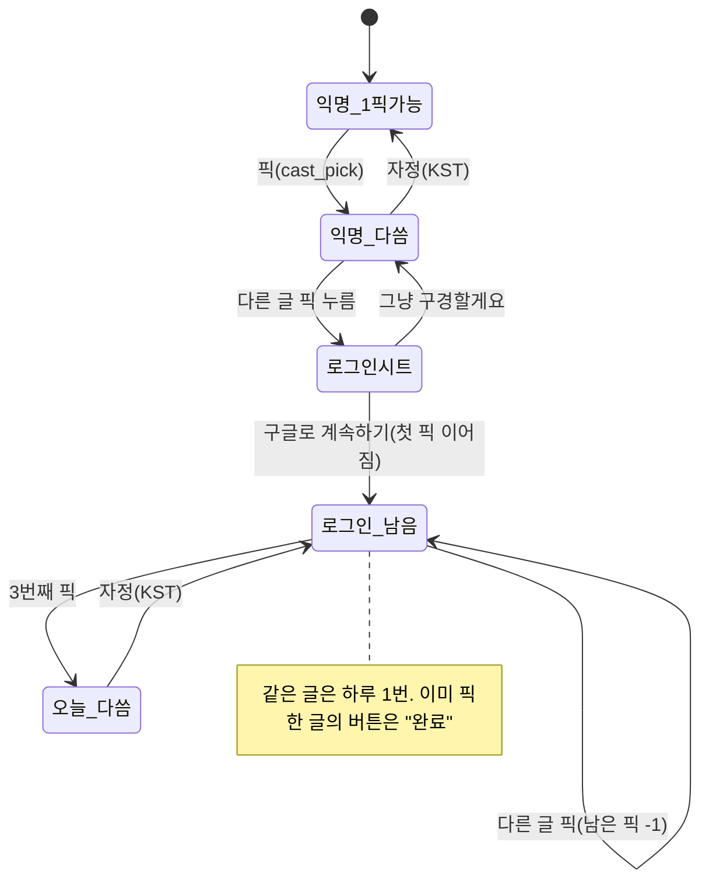
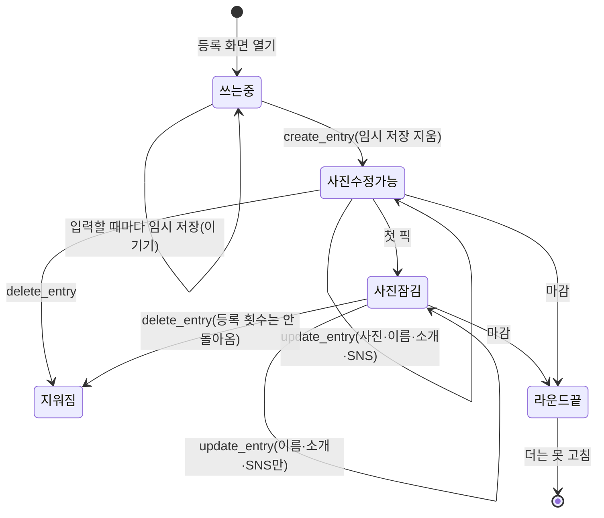

# 프로듀스 댕냥 구현도

- 작성: 2026-11-18 · 상태: 초안(사용자 확인 전)
- 기준 문서: [설계서](설계서.md)(기술·아키텍처 선택 이유) · [디자인 시스템](design/DESIGN_SYSTEM.md)(확정안 V2A) · [기획서](기획서.md)
- 그림 원본: `docs/diagrams/구현도.mjs`. 고칠 때는 아래 명령으로 다시 렌더해서 같은 커밋에 넣어요.
  `node ~/.claude/skills/doc-diagrams/scripts/render.mjs docs/diagrams/구현도.mjs docs/images`

## 1. 전체 구성도



요청이 지나가는 순서는 다음과 같아요. 응답은 같은 길을 거꾸로 돌아가요.

| 번호 | 구간 | 하는 일 |
|---|---|---|
| ① | 브라우저·PWA → Cloudflare Workers | HTTPS. 화면 HTML과 공유 미리보기 이미지를 캐시해요 |
| ② | Workers → Next.js 화면·서버 함수 | 화면 모듈 9개(기능 폴더 8개 + 공유 미리보기 이미지)가 화면을 그려요. 규칙은 직접 판단하지 않고 DB 함수를 불러요 |
| ③ | Next.js → Supabase | 읽기는 RLS가 걸린 표·뷰로, 쓰기는 RPC(`cast_pick`, `create_entry`, `add_comment` 등)로만 해요. 표에 바로 쓰는 길은 RLS로 막아요 |
| ④ | Supabase → 외부 서비스 | Edge Function이 Gmail SMTP(메일), Web Push(푸시)를 보내고, 구글 OAuth와 Turnstile을 확인해요 |

비밀값(서버 키, 메일 키, 푸시 키)은 그림에 이름만 있어요. Cloudflare·Supabase 비밀값 저장소에 두고, 저장소에는 `.env.example`만 둬요.

## 2. 픽 요청 흐름



1. 처음 온 사람이 얼굴 픽을 누르면 Turnstile 토큰과 함께 **익명 로그인**을 하고 `cast_pick`을 불러요. DB는 잠금을 잡고, 익명 사용자의 오늘 픽이 0개인지 본 뒤 저장해요.
2. 두 번째 픽은 서버에 보내지 않아요. 화면이 바로 **로그인 시트**를 띄워요. 등록·댓글 버튼도 같은 시트를 써요.
3. "구글로 계속하기"는 `linkIdentity(google)`로 익명 계정에 구글을 붙여요. 사용자 번호가 같아서 첫 픽이 그대로 이어져요. 이미 가입된 구글 계정이면 Edge Function `merge-anon`이 익명 계정의 픽을 그 계정으로 옮겨요.
4. 로그인한 뒤에는 게시판마다 하루 3픽이에요. 같은 글은 하루 1픽이에요(`picks` 유일 키: voter_id + entry_id + kst_date).

## 3. 예약 작업 흐름



모두 pg_cron이 한국 시간 자정(UTC 15:00)에 돌려요. 결과 확정이 끝나야 결선 준비가 돌도록 한 작업 안에서 차례로 불러요.

| 작업 | 언제 | 하는 일 | 받는 쪽 |
|---|---|---|---|
| 결과 확정 `finalize_due_rounds()` | 매일 00:00 | 마감된 라운드를 닫고 표를 다시 세서 순위를 확정해요. 동점이면 그 표 수에 먼저 도달한 글이 위예요 | `round_results` → 메인 표지·센터 |
| 알림 발송 | 결과 확정 직후 | `notifications`를 쓰고 pg_net으로 `dispatch-notifications` 함수를 불러 메일·푸시를 보내요. 실패해도 알림함에는 남아요 | 1·2위 주인 |
| 결선 준비 `prepare_final()` | 21일 00:00(3주차 확정 직후) | 주간 1~2위를 결선 라운드로 복사해요. 빠진 자리는 3위가 이어받아요 | 데뷔조 후보 |
| 달 라운드 만들기 `ensure_month_rounds()` | 매달 1일 00:00 | 그달 라운드 4개(1~7, 8~14, 15~20, 22~말일, 21일은 비움 #41)를 만들어요. 이미 있으면 건너뛰어요 | 게시판·일정 |

## 4. 폴더 구조

기능(feature) 폴더가 기본이에요. `app/`의 라우트는 얇게 두고, 화면 조립은 각 기능 폴더가 맡아요. 이렇게 고른 이유는 설계서 2절에 있어요.

```
produce-daengnyang/
├─ app/                          라우트만(얇게)
│  ├─ layout.tsx                 글꼴(next/font: Black Han Sans·Gowun Dodum)·tokens.css·PWA 메타
│  ├─ Providers.tsx              토스트 → 로그인 시트 → 오늘 남은 픽(레이아웃이 서버에서 처음 값을 넣음)
│  ├─ not-found.tsx·error.tsx    없는 주소·오류 안내
│  ├─ page.tsx                   메인 · 11월호 표지
│  ├─ [board]/page.tsx           게시판(dog | cat)
│  ├─ [board]/[id]/page.tsx      글 상세 + opengraph-image.tsx(공유 미리보기)
│  ├─ register/ hall/ inbox/ me/ admin/
│  ├─ auth/callback/route.ts     구글 로그인 돌아오는 곳(code → 세션 쿠키, 이미 가입된 계정이면 /auth/merge)
│  ├─ auth/merge/page.tsx        이미 가입된 구글 계정일 때 익명 픽 옮기기(MergeFlow)
│  └─ manifest.ts
├─ features/
│  ├─ picks/                     PickButton(얼굴)·PicksLeft(윗줄 얼굴 3개)·PicksProvider(남은 픽 상태)·VoteCount·messages.ts·api
│  ├─ entries/                   BoardPage·DetailPage·EntryCard·BoardGallery(더 보기)·PhotoPager(1~3장 넘김)·RecruitAd·SiteNav
│  │                             (#5) RegisterForm·EditForm·SearchBox·MyEntries
│  │                             photo.ts(WebP 1600·480px·위치 정보 제거)·draft.ts(임시 저장)·api
│  ├─ rounds/                    schedule.ts(라운드 일정·가림 여부 계산, 순수 함수)·Band(마감 띠)·Chart
│  ├─ featured/                  MainPage·Cover(표지 넘김, 데스크톱 펼침면)·CenterSpread·Polaroids·CenterBanner(게시판·상세 위 센터 띠)·server.ts(get_featured 요청당 한 번)
│  ├─ sns/                       SnsLink(클릭 기록 링크)·Impression(노출 기록)·track.ts(record_sns 를 fetch 로)
│  ├─ comments/                  CommentList·CommentForm·ReportButton(글·댓글 같이 씀)
│  ├─ auth/                      LoginSheet(구글로 계속하기)·LoginButton·session.ts(익명 로그인·구글 연결)·MergeFlow
│  ├─ notifications/             Inbox·push.ts(구독 등록)
│  └─ admin/                     신고 처리·숨기기
├─ shared/
│  ├─ ui/                        TopBar·Toast·Sheet·Notice·parts(SectionHead·Toc·Colophon·SortLinks)·ui.module.css(알약·탭)
│  ├─ lib/                       supabase(client·server·env·database.types)·kst.ts·format.ts·visitor.ts(방문자 키 쿠키 pd_vid)·turnstile.ts(봇 확인)·next-path.ts
│  └─ styles/tokens.css          디자인 토큰 원본(#1에서 docs/design/ 에서 옮겨 옴)
├─ middleware.ts                 로그인 세션 갱신(로그인 쿠키가 있을 때만, Edge 런타임)
├─ public/                       sw.js·아이콘
├─ supabase/
│  ├─ migrations/                스키마 → RLS → 규칙 함수 → 예약 작업 순서
│  ├─ functions/                 dispatch-notifications(메일·푸시)·merge-anon
│  ├─ tests/                     pgTAP(픽 한도·동시 클릭·결과 확정)
│  └─ seed.sql·seed-photos/       로컬 개발용 예시 데이터·CC0 사진(seed-photos.sh 로 로컬 Storage 에 올림)
└─ tests/e2e/                    Playwright(익명 1픽 → 로그인 → 3픽, 등록, 댓글)
```

| 기능 폴더 | 쓰는 부품(DESIGN_SYSTEM.md 5절) | 부르는 DB 함수·표 |
|---|---|---|
| picks | 얼굴 픽 버튼, 윗줄 남은 픽, 토스트 | `cast_pick`, `picks`(내 것만 읽힘, RLS) |
| entries | 게시판 카드, 정렬, 모집 공고, 사진 넘김·검색칸·내 글 목록(구현 때 추가) | `create_entry`, `update_entry`, `delete_entry`, `board_entries(q)`, `record_view` |
| rounds | 마감 띠, 탭, 차트 줄(▲▼) | `rounds`, `board_entries`(`prev_rank`), `rank_snapshots`·`snapshot_ranks()`(#7 자정 실행) |
| featured | 표지, 센터 화보, 폴라로이드, 위 센터 띠 | `get_featured()`(`round_results` 를 순위로 골라 줌) |
| sns | SNS 링크·노출 기록 | `record_sns`(`sns_events`) |
| comments | 댓글, 신고 버튼 | `add_comment`, `delete_comment`, `report`, `comments` |
| auth | 로그인 시트 | Supabase Auth, `merge-anon` |
| notifications | 알림함 | `notifications`, `push_subscriptions` |

## 5. 상태도

### 5-1. 라운드



### 5-2. 픽 버튼(한 게시판 기준)



### 5-3. 내 글(사진 잠금)


